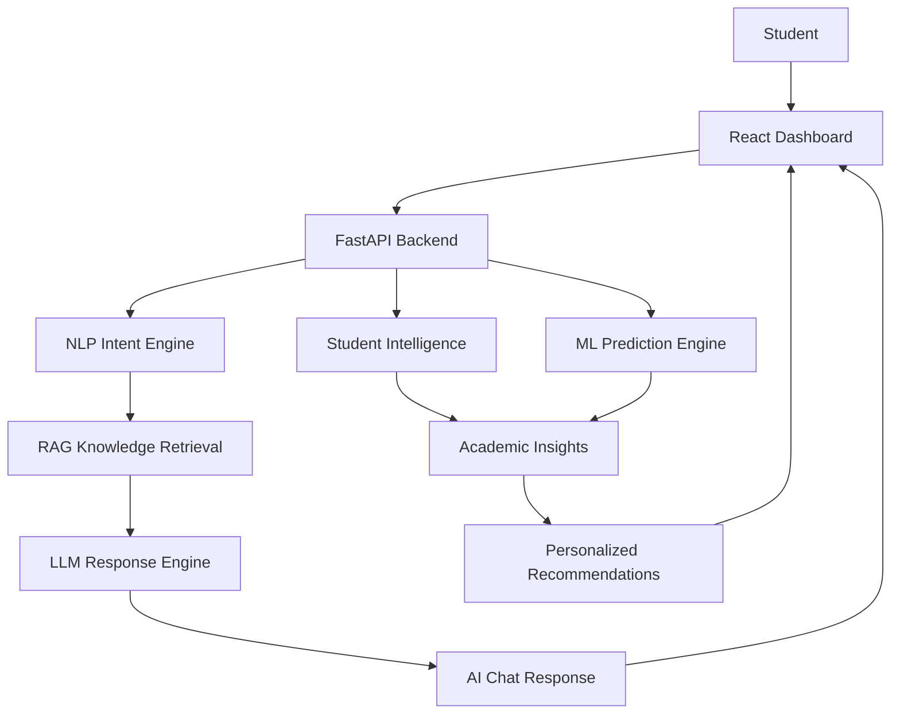

# 🎓 EDUASSIST AI
### Cloud-Based AI Academic Assistant for Student Performance Enhancement

**Transforming student data into meaningful academic insights with Machine Learning, NLP, and Retrieval-Augmented Generation (RAG).**

EduAssist AI is an intelligent academic assistance platform designed to analyze student performance, identify learning gaps, understand academic progress, and provide personalized recommendations. By combining machine learning predictions with an AI-powered conversational assistant, the platform helps students better understand their performance and plan their next steps toward academic improvement.

<p align="center">

  
  
  
  
  

</p>

---

## 🌟 Why EduAssist AI?

Academic data often contains valuable information about a student's strengths, weaknesses, engagement, and future performance. However, interpreting this information and turning it into an actionable learning plan can be challenging.

**EduAssist AI bridges that gap.**

Instead of presenting only marks and statistics, it combines predictive analytics and conversational AI to help answer questions such as:

- 📊 How am I performing academically?
- 🎯 Which areas need the most improvement?
- 📈 Is my academic performance improving or declining?
- 🧠 What factors may be affecting my performance?
- 💬 How can I improve my academic outcomes?
- 📅 What should I study next, and how should I plan my learning?

## ✨ Key Features

### 📊 1. Student Performance Intelligence
- Analyzes student assessment data and academic scores.
- Summarizes average, highest, and lowest assessment performance.
- Identifies academic strengths and potential learning gaps.
- Presents student-specific performance indicators through a dashboard.

### 🔍 2. Academic Insights & Trend Analysis
- Evaluates changes in academic performance.
- Identifies weak assessments and inconsistent results.
- Analyzes student engagement indicators, including activity and resource usage.
- Generates actionable suggestions based on observed academic patterns.

### 🤖 3. Machine Learning Predictions
EduAssist AI uses trained machine learning models to support academic forecasting and risk analysis.

- **Gradient Boosting Regressor:** Predicts future academic performance.
- **Random Forest Classifier:** Supports student academic risk classification.
- **Scikit-learn:** Provides the machine learning framework for training and inference.

Predictions are intended to support early intervention and informed learning decisions, not to replace educators or guarantee academic outcomes.

### 💬 4. AI Academic Chatbot
Interact with EduAssist AI using natural-language questions.

The assistant is designed to provide student-focused responses for academic analysis, performance questions, improvement suggestions, and study planning.

### 🧠 5. NLP & Retrieval-Augmented Generation
The AI pipeline combines intent recognition with knowledge retrieval and response generation.

- **NLP Intent Engine:** Identifies the purpose of a student's question.
- **RAG Knowledge Pipeline:** Retrieves relevant information from a knowledge base.
- **LLM Response Engine:** Generates conversational answers using the available context.
- **Academic Intelligence:** Connects student-specific insights with relevant recommendations.

### 📅 6. Personalized Learning Recommendations
- Highlights areas that may require attention.
- Suggests practical improvement actions.
- Supports personalized study planning.
- Connects academic insights with the student's learning goals.

---

## 🏗️ System Architecture

EduAssist AI combines a React frontend, a FastAPI backend, machine learning models, student data processing, and an AI response pipeline.



### How It Works

1. **Input:** The student loads their academic profile and submits a question.
2. **Processing:** The backend retrieves student information and computes relevant academic indicators.
3. **Prediction:** Machine learning models support performance forecasting and risk classification.
4. **Understanding:** The NLP engine identifies the intent behind the student's question.
5. **Knowledge retrieval:** The RAG pipeline retrieves relevant contextual information.
6. **Response:** The assistant returns academic insights, explanations, and improvement suggestions through the dashboard.

---

## 🛠️ Technology Stack

| Category | Technologies |
|---|---|
| Frontend | React.js, Vite, CSS |
| Backend | Python, FastAPI |
| Machine Learning | Scikit-learn, Gradient Boosting, Random Forest |
| Data Processing | Pandas, NumPy |
| NLP & Generative AI | Intent recognition, LLM integration, RAG |
| Vector Search | FAISS |
| Embeddings | Hugging Face Sentence Transformers |
| Dataset | Open University Learning Analytics Dataset (OULAD) |
| API Documentation | FastAPI Swagger UI |
| Development Tools | Visual Studio Code, Git, GitHub |

---

## 📂 Project Structure

```text
EduAssist-AI/
│
├── backend/
│   ├── main.py
│   ├── student_intelligence.py
│   ├── academic_insights.py
│   ├── intent_engine.py
│   ├── ai_orchestrator.py
│   ├── rag_engine.py
│   └── llm_engine.py
│
├── frontend/
│   ├── src/
│   │   ├── App.jsx
│   │   ├── App.css
│   │   └── index.css
│   ├── package.json
│   └── vite.config.js
│
├── data/
│   └── processed/
│
├── Dataset/
│   └── OULAD/
│
├── knowledge_base/
├── models/
├── notebooks/
├── vector_store/
├── .gitignore
└── README.md
```

*Note: The structure above highlights the main project components. Some generated data, datasets, or model artifacts may be excluded from GitHub and need to be prepared locally.*

---

## 🚀 Getting Started

Follow these steps to run EduAssist AI locally.

### Prerequisites

Install the following before starting:

- Python 3.11
- Node.js and npm
- Git

### 1. Clone the Repository

```bash
git clone https://github.com/YOUR_USERNAME/EduAssist-AI.git
cd EduAssist-AI
```

Replace `YOUR_USERNAME` with your GitHub username.

### 2. Set Up the Python Environment

If the project includes a usable local virtual environment, activate it in PowerShell:

```powershell
.\.venv\Scripts\Activate.ps1
```

Otherwise, create a new environment:

```powershell
python -m venv .venv
.\.venv\Scripts\Activate.ps1
```

Install the backend dependencies using the project's dependency file, if available. For example:

```powershell
pip install -r backend\requirements.txt
```

If a `requirements.txt` file is not present, create one from the project's actual backend dependencies before running this command.

### 3. Prepare the Required Data and Models

The project uses processed student data and trained model artifacts.

- Obtain and prepare the required OULAD dataset files.
- Place the processed data in the expected project directory.
- Ensure the trained model files and FAISS vector index are available.
- Configure any required LLM credentials through environment variables; never commit API keys or `.env` files.

Raw datasets and generated artifacts may not be included in the repository.

### 4. Start the Backend

Open a terminal:

```powershell
cd backend
uvicorn main:app --reload
```

The FastAPI backend should be available at:

**http://127.0.0.1:8000**

Explore the interactive API documentation at:

**http://127.0.0.1:8000/docs**

### 5. Start the Frontend

Open a second terminal:

```powershell
cd frontend
npm install
npm run dev
```

Open the local URL displayed by Vite, typically:

**http://localhost:5173**

Keep both the backend and frontend terminals running while using the application.

---

## 🧪 Machine Learning & Academic Analytics

The machine learning component is designed to derive insights from historical student assessment and engagement data.

| Component | Purpose |
|---|---|
| Performance prediction | Estimates future academic performance |
| Risk classification | Supports identification of students who may need additional attention |
| Assessment analysis | Summarizes academic strengths and weaknesses |
| Trend analysis | Examines changes in assessment results |
| Engagement analysis | Uses available activity indicators to understand learning patterns |
| AI recommendations | Converts relevant findings into actionable guidance |

The project uses the **Open University Learning Analytics Dataset (OULAD)** as its academic data source. Model predictions depend on the quality, availability, and distribution of the prepared data.

---

## ☁️ Cloud Deployment Vision

EduAssist AI is designed around a modular frontend and backend architecture that can be extended toward cloud deployment.

Potential deployment components include:

- **Frontend hosting:** A static web hosting service.
- **Backend hosting:** A cloud-hosted FastAPI service.
- **Data storage:** Managed storage or a suitable cloud database.
- **Model serving:** Deployment of trained models behind API endpoints.
- **AI services:** Securely configured embedding and language-model services.

Cloud deployment is a planned extension of the project; the local development setup described above does not imply that a production deployment is already live.

---

## 🔐 Security & Responsible AI

- Keep API keys, credentials, and environment variables out of version control.
- Avoid exposing personal student information in public repositories.
- Treat predictions as decision-support estimates rather than definitive judgments.
- Protect student data when deploying the application.
- Provide academic recommendations as guidance, not guarantees.

---

## 🎯 Project Objectives

EduAssist AI aims to:

- Make academic performance easier to understand.
- Identify potential learning gaps early.
- Support data-driven academic decision-making.
- Provide accessible, conversational academic assistance.
- Encourage personalized and proactive learning.
- Establish a foundation for future cloud-based educational intelligence.

---

## 🔮 Future Enhancements

- ☁️ Deploy the complete application on a cloud platform.
- 🔐 Add secure authentication and role-based access.
- 📱 Improve the experience for mobile and tablet users.
- 📚 Expand the academic knowledge base and RAG retrieval quality.
- 📈 Add richer historical progress visualizations.
- 🎯 Improve recommendation personalization and model evaluation.
- 🧑‍🏫 Introduce educator-facing academic monitoring and intervention tools.

---

## 👩‍💻 About the Project

**Project:** EDUASSIST AI – Cloud-Based AI Academic Assistant for Student Performance Enhancement

**Domain:** Artificial Intelligence, Machine Learning, Educational Technology, NLP, and Cloud Computing

**Purpose:** To transform academic data into understandable insights and personalized learning guidance.

**Status:** Active development

---

## 🤝 Contributing

Suggestions, bug reports, and ideas for improving educational AI systems are welcome. Before proposing changes, please describe the problem, the intended improvement, and any relevant testing.

## 📜 License

A license has not yet been specified. Add an appropriate open-source license before granting others permission to reuse, modify, or distribute this project.

---

<p align="center">

### 🎓 Learn Smarter. Understand Better. Improve Continuously.

**EduAssist AI — Turning Academic Data into Actionable Learning Intelligence.**

</p>
